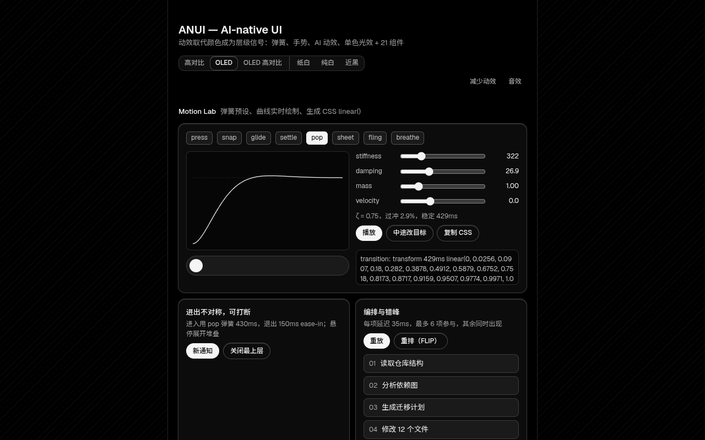
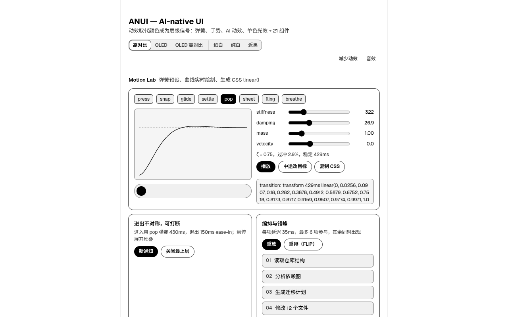
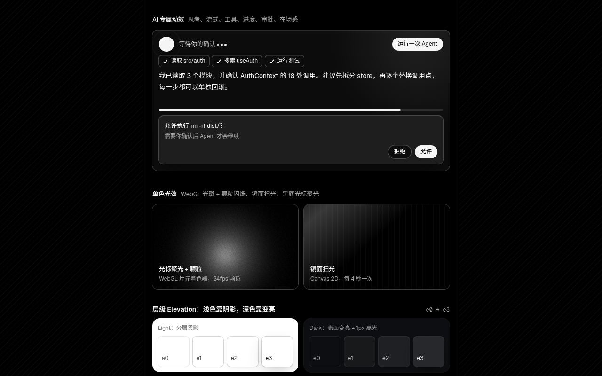

# ANUI — AI-Native UI Skill

[简体中文](README.md) · **English**

> An AI-app interface design skill for Codex: **monochrome themes + spring motion + Chinese typography + AI-native components + self-check scripts**.

<p align="center">
  
</p>

**Live demo**: https://yamyyyyy.github.io/ai-native-ui-skill/?lang=en (available once deployed); full recording: [`docs/media/preview.mp4`](docs/media/preview.mp4)

| OLED (dark default) | High-contrast HC (light default) |
|---|---|
|  |  |



## What it is

ANUI is a design system written for coding agents to read. Once installed in Codex, the agent uses its tokens, motion and craft rules when it builds chat panels, agent workspaces, tool-call streams and approval cards, then checks its own work with scripts.

- **OLED / HC monochrome**: the light default is pure-white high-contrast `hc` and the dark default is pure-black `oled`. `oled-hc`, `paper`, `white` and `dark` are also available. Colour doesn't carry hierarchy: the only hue is a functional red, and emphasis comes from inversion. Contrast targets are derived from APCA + WCAG and verified by script.
- **Spring motion**: 8 presets (press / snap / glide / settle / pop / sheet / fling / breathe), defined Apple-style by duration + bounce. A closed-form solver generates CSS `linear()`. Motion is interruptible, uses asymmetric enter/exit and respects reduced motion.
- **Chinese typography**: Geist + ANUI Sans SC (a Noto Sans SC subset) + Geist Mono, with `text-autospace`, `text-spacing-trim`, `line-break: strict`, and weight compensation for dark and high-contrast themes.
- **AI-native components**: 21 components, including thinking traces, streamed answers, tool-call chips, approval cards, task rows, a Prompt Bar (with an IME guard), Diff / Records tables and insight cards. There's also AI-specific motion: thinking breath, streaming front, tool progress and presence.
- **Self-check scripts**: `npm run check` uses Playwright to open the demo in all 6 themes (plus English runs). It checks for JS errors, external requests, clipped shadows (clip-audit `cut = 0`), the font-size whitelist (12 / 13 / 14 / 20), token contrast and untranslated text in English mode.

## Install in Codex

```bash
# User-level (all projects)
git clone https://github.com/yamyyyyy/ai-native-ui-skill ~/.agents/skills/anui

# Or project-level
git clone https://github.com/yamyyyyy/ai-native-ui-skill .agents/skills/anui
```

Then paste the snippet from [`AGENTS.md`](AGENTS.md) into the `AGENTS.md` at your project root, so Codex reads `SKILL.md` before doing UI work.

> The directory name should match `name: anui` in the `SKILL.md` frontmatter.

## Quick start

- **See it**: open `demo/index.html` in a browser (offline, no external requests).
  - `?theme=hc|oled|oled-hc|paper|white|dark` switches theme and `?rm` simulates reduced motion.
  - `?lang=en` (or the **EN / 中文** button at the top) switches the UI to English. The default is Chinese and the choice is remembered.
- **Use it in a project**: tell Codex "use the anui skill to build an approval card for this chat panel". The skill loads `references/tokens.md`, `components.md`, `motion-advanced.md` and so on via the routing table in `SKILL.md`.
- **Tokens only**: copy the theme blocks and the `@theme` mapping from `demo/src/app.css` (explained in `references/tokens.md`).

## Languages

- `SKILL.md` is English-first, with the Chinese typography notes kept in Chinese. `AGENTS.md`, `CHANGELOG.md` and `CONTRIBUTING.md` are bilingual.
- `references/*.md` (Chinese) are canonical. `references/en/*.md` are full English translations with matching headings. If the two disagree, the Chinese file wins.
- The demo's Chinese strings are the source of truth. `demo/i18n-en.js` maps them to English and `demo/i18n.js` applies them at runtime.

## Structure

```text
SKILL.md                 Skill entry point (name: anui) and per-task routing table
AGENTS.md                Snippet to paste into a project's AGENTS.md
references/
  tokens.md              ANUI tokens (themes, CSS variables, Tailwind/shadcn mapping)
  monochrome.md          Advanced monochrome: hierarchy, material, dark islands, contrast, Chinese typography
  motion-advanced.md     Spring presets, gestures, AI motion, light effects, sound, performance
  components.md          Specs for 21 components
  craft-rules.md         Craft rules: shadow clipping, IME, scroll-follow…
  acceptance.md          Delivery acceptance checklist
  sources.md             Sources and evidence levels
  en/                    English translations of the above (Chinese is canonical)
scripts/
  check.mjs              One-shot self-check (Playwright)
  perf.mjs               Frame-timing sampler
  clip-audit.js          Shadow-clipping audit (from desktop-agent-ui, MIT)
  contrast.py            APCA + WCAG contrast
demo/                    Single-page demo (index.html, spring.js, presets.js, motion.*, i18n.js, i18n-en.js, assets/)
docs/media/              GIFs and screenshots for the README
```

## Verification scripts

```bash
npm install
npm run browsers          # downloads Chromium; or use CHROME_PATH=/path/to/chrome
npm run check             # all 6 themes + English runs; reports go to reports/
npm run perf              # optional: frame timing for scripted interactions → reports/perf.json
npm run build:css         # rebuild Tailwind after editing demo/src/app.css
```

`check` needs Python 3 for `scripts/contrast.py`. Use `THEMES=hc,oled` to test only some themes, `EN_THEMES=hc,oled` (default; `none` to skip) to pick the English runs, and `SHOTS=1` to save screenshots too.

## Credits (inspired by / built upon)

- [beautiful-ui](https://github.com/slev12397/beautiful-ui) ([beautifului.dev](https://beautifului.dev)) — MIT, © 2026 Shane Levine. It inspired the component anatomy and sizing; this repo contains none of its source, images or sample content.
- [desktop-agent-ui](https://github.com/Ludi-Herry/desktop-agent-ui) — MIT, © 2026 Desktop Agent UI Contributors. It's the source of the craft rules, and `scripts/clip-audit.js` is copied verbatim.
- Fonts: Geist / Geist Mono (OFL 1.1) and Noto Sans SC (OFL 1.1; the subset is renamed ANUI Sans SC).

See [`THIRD_PARTY_LICENSES.md`](THIRD_PARTY_LICENSES.md) and [`NOTICE`](NOTICE). Released under the [MIT](LICENSE) licence.
