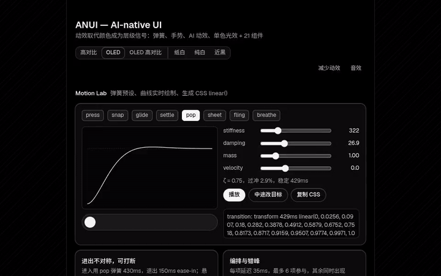

# AI-Native UI Skills

**简体中文** · [English](README.en.md)

> 给 Codex 用的 **AI 原生界面 Skill 合集**，专注**黑白美学**：单色令牌、弹簧动效、中文排版、AI 专属组件，每个 Skill 自带演示与自检脚本。

<p align="center">
  
</p>

**在线站点**：https://yamyyyyy.github.io/ai-native-ui-skill/ （部署后可用）

## Skills

| Skill | 简介 | 演示 | 安装（用户级） |
|---|---|---|---|
| [ANUI](skills/anui/README.md) | OLED / HC 单色令牌 + 8 个弹簧预设 + 中文排版 + 21 个 AI-native 组件 + Playwright 自检 | [Demo](https://yamyyyyy.github.io/ai-native-ui-skill/skills/anui/demo/) | `npx degit yamyyyyy/ai-native-ui-skill/skills/anui ~/.agents/skills/anui` |

## 只安装一个 Skill 到 Codex

Codex 从 `~/.agents/skills/<name>/`（用户级）或项目内 `.agents/skills/<name>/`（项目级）读取 Skill。目录名须与 `SKILL.md` frontmatter 中的 `name` 一致。

```bash
# 方式一：degit（只下载该子目录，不含 git 历史）
npx degit yamyyyyy/ai-native-ui-skill/skills/anui ~/.agents/skills/anui     # 用户级
npx degit yamyyyyy/ai-native-ui-skill/skills/anui .agents/skills/anui       # 项目级

# 方式二：git 稀疏检出（便于之后 git pull 更新）
git clone --depth 1 --filter=blob:none --sparse https://github.com/yamyyyyy/ai-native-ui-skill /tmp/ai-native-ui-skill
git -C /tmp/ai-native-ui-skill sparse-checkout set skills/anui
cp -R /tmp/ai-native-ui-skill/skills/anui ~/.agents/skills/anui
```

然后按各 Skill README 的说明，把它的 `AGENTS.md` 片段（如 [`skills/anui/AGENTS.md`](skills/anui/AGENTS.md)）粘到你项目根目录的 `AGENTS.md`。

## 仓库结构

```text
skills/
  anui/                  ANUI Skill（SKILL.md、AGENTS.md、references/、demo/、scripts/、docs/media/）
site/index.html          GitHub Pages 首页（Skill 列表）
scripts/build-site.mjs   组装 Pages 站点 → _site/（首页 + skills/<name>/demo/）
.github/workflows/       CI：npm run check 通过后部署 Pages
LICENSE  NOTICE  THIRD_PARTY_LICENSES.md  CONTRIBUTING.md  CHANGELOG.md
```

## 开发与自检

```bash
npm install
npm run browsers      # 或设置 CHROME_PATH
npm run check         # ANUI：6 个主题 + 2 个英文运行
npm run build:site    # 本地组装 Pages 站点到 _site/
```

## 新增 Skill

未来的 UI Skill 以兄弟目录加入 `skills/<name>/`：带 frontmatter 的 `SKILL.md`、中英双语 README、自检脚本，并在上表登记。详见 [CONTRIBUTING.md](CONTRIBUTING.md#新增-ui-skill--adding-a-new-ui-skill)。

## 许可

[MIT](LICENSE)。第三方素材见 [`THIRD_PARTY_LICENSES.md`](THIRD_PARTY_LICENSES.md) 与 [`NOTICE`](NOTICE)。
